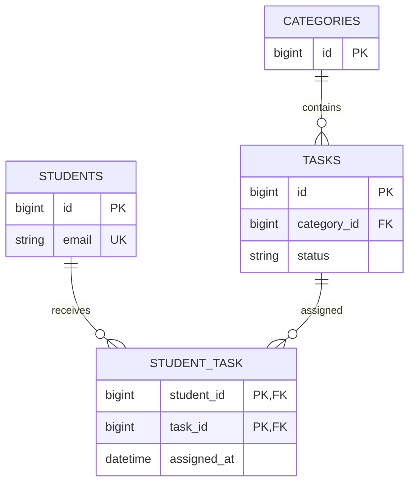

# From requirements to relational tables

“Students receive tasks; each task has a category” gives three entities: students, tasks and categories. Assignment is a relationship with its own date, so it needs a fourth table.

| Table | Actual columns and types | Purpose |
|---|---|---|
| students | id BIGINT unsigned PK auto increment; name VARCHAR(255); email VARCHAR(255) UNIQUE; created_at/updated_at TIMESTAMP nullable | One row per learner |
| categories | id BIGINT unsigned PK auto increment; name VARCHAR(255) UNIQUE; timestamps | One reusable subject |
| tasks | id BIGINT unsigned PK auto increment; title VARCHAR(120); description TEXT nullable; due_date DATE nullable; status ENUM(pending,in_progress,done) default pending; category_id BIGINT unsigned FK; timestamps | One piece of work, one overall status |
| student_task | student_id BIGINT unsigned FK; task_id BIGINT unsigned FK; assigned_at DATETIME; composite PK(student_id,task_id) | One student/task assignment |

All four use InnoDB, which supports transactions and foreign keys. The migration is `database/migrations/2026_11_04_000001_create_training_tables.php`. Laravel also maintains a migrations bookkeeping table.



A primary key uniquely identifies a row. A foreign key points to an existing parent row. The composite primary key identifies an assignment by **both** IDs and rejects duplicates. No assignment ID is needed.

Indexes speed lookups at the cost of storage and write work. Email and category name have unique indexes. Tasks index due_date, status and category_id. The pivot primary key supports lookup by student; its task foreign key receives an index in MariaDB. Small tables may still be scanned because an index is not always cheaper.

One-to-one means at most one related record on either side, such as a student and a student profile with UNIQUE student_id. PMT does not need that table. One-to-many means one category has several tasks, each with one category. Many-to-many means Sara can receive several tasks and each task can be assigned to Sara and Omar.

Normalization keeps each fact in one place. Store category name in categories and refer to its key. Do not repeat student emails in tasks. Comma-separated student IDs cannot enforce individual foreign keys or composite uniqueness and make filtering and removal difficult. The pivot stores one relationship per row.

## Deletion rules

Deleting a task cascades to its student_task rows, preserving students and categories. Deleting a student cascades to that student's assignments, preserving tasks. Deleting a category with tasks is restricted; first deliberately move or delete those tasks. Student/category deletion APIs are outside this lesson. Never disable constraints to bypass these rules. Migration `down()` is destructive and is only appropriate for disposable databases or explicitly approved rollback.

## JOIN versus junction table

A junction table is stored data representing many-to-many relationships. A JOIN is a query operation combining rows. A JOIN does not create a junction table and can also query one-to-many relationships.

Run these read-only examples in phpMyAdmin after seeding:

```sql
-- INNER JOIN shows matching assignments only.
SELECT s.name, t.title, st.assigned_at
FROM students AS s
INNER JOIN student_task AS st ON st.student_id = s.id
INNER JOIN tasks AS t ON t.id = st.task_id
ORDER BY s.id, t.id;

-- LEFT JOIN keeps even tasks without assigned students.
SELECT t.title, s.name
FROM tasks AS t
LEFT JOIN student_task AS st ON st.task_id = t.id
LEFT JOIN students AS s ON s.id = st.student_id
ORDER BY t.id, s.id;

SELECT t.title, c.name AS category
FROM tasks AS t INNER JOIN categories AS c ON c.id = t.category_id;
SHOW CREATE TABLE student_task;
SHOW TABLE STATUS WHERE Name IN ('students','categories','tasks','student_task');
```

With fresh deterministic seed data, the HTML task has two students, Sara has three tasks, Nabil has no assignments, and “Explain database joins” is unassigned. Actual IDs should always be checked in the tables.
