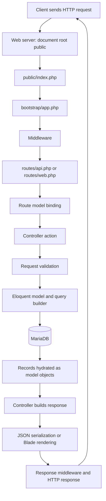

# MVC and the request lifecycle

Model means database behavior and relationships: app/Models/Task.php. View means rendered presentation: resources/views/tasks/index.blade.php. Controller means HTTP coordination: app/Http/Controllers/TaskController.php. An API controller returns JSON directly and does not need a Blade view.



1. A client sends a method, URL, headers and optional body.
2. Apache or artisan's development server receives it. The production document root must be public/, never the project root containing .env.
3. public/index.php loads vendor/autoload.php and calls handleRequest(Request::capture()).
4. bootstrap/app.php creates the Laravel application and registers route files.
5. Laravel applies middleware, including request preparation. Web routes have session and CSRF middleware; API routes are stateless for this lesson.
6. The router matches method and path. Route model binding resolves `{task}` using the Task type. A missing row returns 404 before the action runs.
7. The action validates incoming data. Invalid fields stop processing with 422.
8. Eloquent builds SQL and sends it through PDO to MariaDB.
9. Rows return as models/collections. with() loads related rows without a query for every task.
10. The controller constructs a response. JSON serializes models and relationships; Blade renders escaped HTML.
11. The response passes outward through middleware to the web server and client.

## Trace real endpoints

All rows below start at public/index.php, bootstrap/app.php and the middleware/router steps above.

| Request | Route file → action | Model/database effect | Return |
|---|---|---|---|
| GET /api/tasks | routes/api.php → TaskController::index | Task::with; SELECT + COUNT + related SELECTs | 200 paginated JSON |
| POST /api/tasks | routes/api.php → TaskController::store | validate title/category; Task::create; INSERT | 201 task JSON |
| PATCH /api/tasks/1/status | routes/api.php → TaskStatusController::update | binding; validate status; UPDATE tasks | 200 task JSON |
| POST /api/tasks/1/students | routes/api.php → TaskAssignmentController::store | validate IDs; transaction; INSERT new student_task rows | 200 task JSON |
| GET /api/tasks?student_id=3 | routes/api.php → TaskController::index | whereHas → EXISTS through pivot | 200 filtered paginator |
| GET /tasks | routes/web.php → TaskPageController::index | SELECT tasks, categories, students | 200 rendered tasks/index.blade.php |

```php
return response()->json(['data' => $tasks]); // machine-readable application/json
return view('tasks.index', compact('tasks')); // text/html, variable available in Blade
```

The API wrapper is consistently data. List data contains Laravel paginator metadata and another data array of records. Single-record data contains one object. Errors use Laravel's message/errors shape; 204 has no body.

## Directory map

app/Http/Controllers coordinates HTTP. app/Models owns relationships. routes selects actions. database/migrations defines schema changes; database/seeders inserts examples. config reads .env settings. bootstrap wires Laravel. public is the web entry point. resources/views holds Blade layouts and task pages. storage holds generated logs, sessions and compiled views. tests uses a disposable in-memory database. docs contains these lessons. vendor is generated by Composer and ignored by Git.
