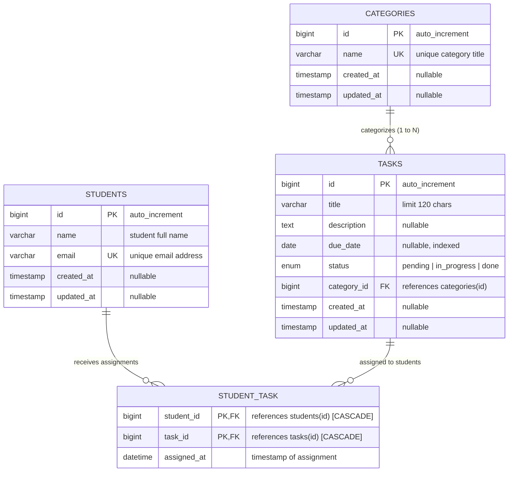

# Comprehensive Guide: Relational Databases, ERDs, and Laravel Eloquent ORM
### Designed for Teaching Students — Task Management Application (PMT)

---

## Table of Contents
1. [Core Foundations: What is a Relational Database?](#1-core-foundations-what-is-a-relational-database)
2. [Database Tables & Schema Design](#2-database-tables--schema-design)
3. [Understanding Relationships & Foreign Keys](#3-understanding-relationships--foreign-keys)
4. [Entity Relationship Diagrams (ERDs) Explained](#4-entity-relationship-diagrams-erds-explained)
5. [The ERD for Our Task Management Application](#5-the-erd-for-our-task-management-application)
6. [Deep Dive into the Existing Tables & Migrations](#6-deep-dive-into-the-existing-tables--migrations)
7. [What is an ORM and Why Do We Use Eloquent?](#7-what-is-an-orm-and-why-do-we-use-eloquent)
8. [Eloquent Relationships in Code (With Examples)](#8-eloquent-relationships-in-code-with-examples)
9. [Under the Hood: SQL vs Eloquent & The N+1 Problem](#9-under-the-hood-sql-vs-eloquent--the-n1-problem)
10. [Student Cheatsheet, Common Mistakes & Practice Exercises](#10-student-cheatsheet-common-mistakes--practice-exercises)

---

## 1. Core Foundations: What is a Relational Database?

A **Relational Database Management System (RDBMS)** stores information across structured, two-dimensional grids called **tables**.

### Anatomy of a Table:
- **Table (Entity / Relation):** A collection of related data representing a specific real-world concept (e.g., `students`, `tasks`, `categories`).
- **Column (Attribute / Field):** A specific piece of data that every record in the table possesses (e.g., `email`, `title`, `due_date`). Each column has a strictly enforced **data type** (`VARCHAR`, `INT`, `DATETIME`, etc.).
- **Row (Record / Tuple):** A single, concrete instance of the entity (e.g., Student #1: Sara Ali).

### The Golden Rule: Database Normalization
> **"One fact in one place."**

Why don't we store everything in a single spreadsheet-like table?
If we had one table with columns: `student_name`, `student_email`, `task_title`, `category_name`:
1. **Redundancy (Wasted Storage):** If Sara has 10 tasks, her email is duplicated 10 times.
2. **Update Anomaly:** If Sara changes her email, we must update 10 different rows. If one fails, data becomes corrupted.
3. **Insertion Anomaly:** How do you add a new category (like "DevOps") before any task has been created for it? You can't, without leaving task and student columns blank (`NULL`).
4. **Deletion Anomaly:** If you delete the last task in a category, you accidentally delete the category itself.

**Solution:** Separate data into distinct tables (`categories`, `tasks`, `students`) and connect them using **Keys** and **Relationships**.

---

## 2. Database Tables & Schema Design

### Keys: How Tables Know Who is Who
1. **Primary Key (PK):**
   - A unique identifier for every single row in a table.
   - Cannot be `NULL`.
   - In modern web frameworks like Laravel, this is usually an auto-incrementing integer: `id BIGINT UNSIGNED AUTO_INCREMENT PRIMARY KEY`.
2. **Composite Primary Key:**
   - A primary key composed of **two or more columns combined**.
   - Example: In our `student_task` table, the pair `(student_id, task_id)` forms the primary key. This guarantees that student #1 cannot be assigned to task #2 twice!
3. **Foreign Key (FK):**
   - A column in one table that points directly to the Primary Key of another table.
   - It enforces **Referential Integrity**: the database refuses to let you enter a `category_id` of `999` if category `999` does not exist in the `categories` table.

### Integrity Rules: On Delete Behaviors
When a parent record is deleted, what happens to the children that point to it?
- **`cascadeOnDelete()` (CASCADE):** If the parent is deleted, delete the children automatically.
  - *Example:* If task #5 is deleted, delete all rows in `student_task` where `task_id = 5`.
- **`restrictOnDelete()` (RESTRICT):** Block the deletion of the parent if child records still exist.
  - *Example:* If category "Laravel" has 3 tasks, deleting the category will throw a foreign key error until those tasks are moved or removed.
- **`nullOnDelete()` (SET NULL):** Keep the child record, but set the foreign key column to `NULL`.

---

## 3. Understanding Relationships & Foreign Keys

Relational databases support three fundamental types of relationships:

### A. One-to-One (1:1)
- **Concept:** Record A is associated with exactly one Record B, and Record B is associated with exactly one Record A.
- **Real-world Example:** A `User` has one `UserProfile`; a `Student` has one `StudentCard`.
- **Where does the Foreign Key go?** Put `student_id UNIQUE` on the `student_cards` table.

### B. One-to-Many (1:N) — *Parent & Children*
- **Concept:** One record in Table A can be associated with multiple records in Table B. But each record in Table B belongs to only one record in Table A.
- **In our App:**
  - One **Category** has **Many Tasks** (`HTML` $\rightarrow$ "Build page", "Semantic tags").
  - Each **Task** belongs to **One Category**.
- **Crucial Rule for Students:** **The Foreign Key ALWAYS lives on the "Many" side!**
  - Table `tasks` contains `category_id`.
  - Table `categories` has NO column named `task_id`.

```
[ categories ]                   [ tasks ]
+----+-------------+            +----+---------------------+-------------+
| id | name        |            | id | title               | category_id |
+----+-------------+            +----+---------------------+-------------+
|  1 | HTML        | <----+     |  1 | Semantic tags       |      1      |
|  2 | CSS         |      +---- |  2 | Build layout        |      1      |
+----+-------------+            |  3 | Responsive grid     |      2      |
                                +----+---------------------+-------------+
```

### C. Many-to-Many (M:N) — *Requires a Pivot/Junction Table*
- **Concept:** One record in Table A can relate to multiple records in Table B, AND one record in Table B can relate to multiple records in Table A.
- **In our App:**
  - One **Student** can be assigned to **Multiple Tasks**.
  - One **Task** can be assigned to **Multiple Students** (group project or shared assignment).
- **Why can't we store this directly?**
  - We cannot put `student_id` in `tasks` (a task has multiple students).
  - We cannot put `task_id` in `students` (a student has multiple tasks).
  - We CANNOT store comma-separated IDs like `"1, 2, 5"` in a single column (violates First Normal Form, prevents indexing, breaks foreign key integrity, makes joins impossible).
- **The Solution:** A **Pivot Table** (also called a Junction Table or Bridge Table).
  - Our table: `student_task`.
  - Holds pairs of foreign keys: `student_id` and `task_id`.
  - Can also hold relationship metadata (e.g., `assigned_at`).

```
[ students ]               [ student_task (PIVOT) ]             [ tasks ]
+----+-------+             +------------+---------+-------------+  +----+------------------+
| id | name  |             | student_id | task_id | assigned_at |  | id | title            |
+----+-------+             +------------+---------+-------------+  +----+------------------+
|  1 | Sara  | <-------+-- |     1      |    1    | 2026-11-04  | -+-> |  1 | Build a page    |
|  2 | Omar  | <--+    |   |     1      |    2    | 2026-11-04  | -|-> |  2 | Style responsive |
+----+-------+    +----+-- |     2      |    1    | 2026-11-04  | -+   +----+------------------+
                           +------------+---------+-------------+
```

---

## 4. Entity Relationship Diagrams (ERDs) Explained

An **ERD (Entity-Relationship Diagram)** is a visual architectural blueprint showing all tables (entities), their columns (attributes), and the connections (relationships) between them.

### Reading Crow's Foot Notation
Relationships are drawn with lines connecting tables. The ends of the lines show **Cardinality** (how many) and **Modality / Optionality** (must it exist, or is it optional?):

| Symbol | Name | Meaning |
|:---:|:---:|:---|
| `||` | One and only one | Exactly one (Mandatory) |
| `|o` | Zero or one | Optional (0 or 1) |
| `}|` | One or more | Mandatory Many (1 to N) |
| `}o` | Zero or more | Optional Many (0 to N) |

---

## 5. The ERD for Our Task Management Application

Here is the exact Entity-Relationship Diagram for our existing application schema (`students`, `categories`, `tasks`, and `student_task`):



### Explaining the Diagram to Students:
1. **`CATEGORIES` to `TASKS` (`||--o{`):**
   - The bar `||` on `CATEGORIES` means **each task must belong to exactly one Category**.
   - The crow's foot with circle `o{` on `TASKS` means **a category can contain zero, one, or many tasks**.
2. **`STUDENTS` to `TASKS` via `STUDENT_TASK`:**
   - Instead of drawing an ambiguous line between students and tasks, the ERD reveals the physical **junction table** `STUDENT_TASK`.
   - A student can have zero or many assignment rows.
   - A task can have zero or many assignment rows.
   - Each row in `STUDENT_TASK` links exactly one student to exactly one task.

---

## 6. Deep Dive into the Existing Tables & Migrations

Let's inspect the actual migration file: `database/migrations/2026_11_04_000001_create_training_tables.php`.

### 1. `students` Table
```php
Schema::create('students', function (Blueprint $table) {
    $table->engine = 'InnoDB';
    $table->id();                               // BIGINT UNSIGNED AUTO_INCREMENT PRIMARY KEY
    $table->string('name');                     // VARCHAR(255) NOT NULL
    $table->string('email')->unique();          // VARCHAR(255) NOT NULL UNIQUE
    $table->timestamps();                       // created_at and updated_at TIMESTAMP NULL
});
```
- **Engine `InnoDB`:** Required for foreign key enforcement and transactions.
- **`unique()` on email:** Guarantees no two students can share an email. Creates a unique database index.

### 2. `categories` Table
```php
Schema::create('categories', function (Blueprint $table) {
    $table->engine = 'InnoDB';
    $table->id();
    $table->string('name')->unique();          // Unique subject (HTML, CSS, etc.)
    $table->timestamps();
});
```

### 3. `tasks` Table
```php
Schema::create('tasks', function (Blueprint $table) {
    $table->engine = 'InnoDB';
    $table->id();
    $table->string('title', 120);              // Max length 120 characters
    $table->text('description')->nullable();   // Long text, can be empty
    $table->date('due_date')->nullable()->index(); // Date with search index
    $table->enum('status', ['pending', 'in_progress', 'done'])
          ->default('pending')
          ->index();                           // ENUM restricted to 3 values
    $table->foreignId('category_id')
          ->constrained()
          ->restrictOnDelete();                // Cannot delete category if tasks exist!
    $table->timestamps();
});
```
- **`foreignId('category_id')->constrained()`:** In Laravel, this shorthand automatically defines `category_id` as `BIGINT UNSIGNED` and adds a foreign key constraint referencing `id` on the `categories` table.
- **`restrictOnDelete()`:** Protects data integrity. If an instructor tries to delete the "Database" category while tasks belong to it, MariaDB/MySQL throws an error and rejects the query.

### 4. `student_task` Pivot Table
```php
Schema::create('student_task', function (Blueprint $table) {
    $table->engine = 'InnoDB';
    $table->foreignId('student_id')->constrained()->cascadeOnDelete();
    $table->foreignId('task_id')->constrained()->cascadeOnDelete();
    $table->dateTime('assigned_at');
    $table->primary(['student_id', 'task_id']); // Composite primary key!
});
```
- **Naming Convention:** In Laravel, default pivot table names are the singular names of both models in alphabetical order (`student` + `task` = `student_task`).
- **Composite Primary Key (`$table->primary(...)`):** Eliminates the need for an auto-incrementing `id` column. A student cannot be assigned to the same task multiple times.
- **`cascadeOnDelete()`:** If a student graduates or is deleted, or if a task is deleted, the corresponding assignment rows in `student_task` are cleaned up automatically.

---

## 7. What is an ORM and Why Do We Use Eloquent?

### The Problem: Object-Relational Impedance Mismatch
- In Object-Oriented Programming (PHP / Laravel), we work with **Objects**, **Methods**, and **Classes**.
- In Databases (SQL), we work with **Tables**, **Columns**, **Foreign Keys**, and **Rows**.

Writing raw SQL inside application code has severe drawbacks:
```php
// Without ORM (Raw SQL):
$result = DB::select("SELECT * FROM tasks WHERE status = 'pending' AND due_date <= NOW()");
// Vulnerable to SQL injection if values are concatenated, tedious to map to objects.
```

### The Solution: Eloquent (Laravel's Active Record ORM)
Eloquent bridges the gap. It maps:
- **A Table** $\longleftrightarrow$ **A Model Class** (`tasks` table $\rightarrow$ `Task` class)
- **A Table Row** $\longleftrightarrow$ **An Object Instance** (`$task = Task::find(1)`)
- **A Column** $\longleftrightarrow$ **An Object Property** (`$task->title`)
- **A Foreign Key Relationship** $\longleftrightarrow$ **A Method on the Model** (`$task->category()`)

---

## 8. Eloquent Relationships in Code (With Examples)

Let's look at how our app's models implement these relationships in PHP.

### Relationship 1: Category $\longleftrightarrow$ Task (One-to-Many)

#### The Parent Model: `Category.php`
```php
namespace App\Models;

use Illuminate\Database\Eloquent\Model;
use Illuminate\Database\Eloquent\Relations\HasMany;

class Category extends Model
{
    protected $fillable = ['name'];

    // One category has many tasks
    public function tasks(): HasMany
    {
        return $this->hasMany(Task::class);
    }
}
```

#### The Child Model: `Task.php`
```php
namespace App\Models;

use Illuminate\Database\Eloquent\Model;
use Illuminate\Database\Eloquent\Relations\BelongsTo;

class Task extends Model
{
    protected $fillable = ['title', 'description', 'due_date', 'status', 'category_id'];

    // Each task belongs to one category
    public function category(): BelongsTo
    {
        return $this->belongsTo(Category::class);
    }
}
```

#### How Students Use It in Code:
```php
// 1. Get the category of a task:
$task = Task::find(1);
echo $task->category->name; // e.g. "HTML"

// 2. Get all tasks in a category:
$category = Category::where('name', 'Database')->first();
foreach ($category->tasks as $t) {
    echo $t->title;
}

// 3. Create a task directly through the relationship:
$category->tasks()->create([
    'title' => 'Learn Eloquent Relationships',
    'status' => 'pending',
]);
// Eloquent automatically sets category_id = $category->id!
```

---

### Relationship 2: Student $\longleftrightarrow$ Task (Many-to-Many via Pivot)

#### `Student.php`
```php
namespace App\Models;

use Illuminate\Database\Eloquent\Model;
use Illuminate\Database\Eloquent\Relations\BelongsToMany;

class Student extends Model
{
    protected $fillable = ['name', 'email'];

    public function tasks(): BelongsToMany
    {
        return $this->belongsToMany(Task::class)->withPivot('assigned_at');
    }
}
```

#### `Task.php`
```php
namespace App\Models;

use Illuminate\Database\Eloquent\Model;
use Illuminate\Database\Eloquent\Relations\BelongsToMany;

class Task extends Model
{
    public function students(): BelongsToMany
    {
        return $this->belongsToMany(Student::class)->withPivot('assigned_at');
    }
}
```

#### Working with the Pivot Table in Code:
```php
$task = Task::find(1);
$student = Student::find(2);

// 1. ATTACH: Assign a student to a task with extra pivot columns
$task->students()->attach($student->id, ['assigned_at' => now()]);

// 2. DETACH: Remove a student from a task
$task->students()->detach($student->id);

// 3. SYNC: Set the exact list of assigned students (detaches unlisted ones)
// Useful when updating a checklist in a form:
$task->students()->sync([
    1 => ['assigned_at' => now()],
    3 => ['assigned_at' => now()],
]);

// 4. ACCESS PIVOT DATA:
foreach ($task->students as $assignedStudent) {
    echo "Student: " . $assignedStudent->name;
    echo " Assigned on: " . $assignedStudent->pivot->assigned_at;
}
```

---

## 9. Under the Hood: SQL vs Eloquent & The N+1 Problem

Students must understand that **Eloquent does not replace SQL; it generates SQL for you.**

### SQL Comparison Table

| Goal | Eloquent | Equivalent SQL Generated |
|---|---|---|
| Find by ID | `Task::find(1);` | `SELECT * FROM tasks WHERE id = 1 LIMIT 1;` |
| Filter pending | `Task::where('status', 'pending')->get();` | `SELECT * FROM tasks WHERE status = 'pending';` |
| Insert record | `Category::create(['name' => 'Docker']);` | `INSERT INTO categories (name, created_at, updated_at) VALUES ('Docker', NOW(), NOW());` |
| Get Category for Task | `$task->category;` | `SELECT * FROM categories WHERE id = ? LIMIT 1;` |
| Get Students for Task | `$task->students;` | `SELECT students.*, student_task.assigned_at FROM students INNER JOIN student_task ON students.id = student_task.student_id WHERE student_task.task_id = ?;` |

### The Infamous "N+1 Problem" (Must Teach!)
Suppose we want to display a list of 100 tasks and each task's category name.

#### ❌ The Bad Way (Lazy Loading):
```php
$tasks = Task::all(); // 1 Query: SELECT * FROM tasks;

foreach ($tasks as $task) {
    echo $task->category->name; // Runs 1 query PER TASK! (100 queries)
}
// Total = 1 + 100 = 101 queries! (Performance disaster)
```

#### ✅ The Good Way (Eager Loading with `with()`):
```php
$tasks = Task::with('category')->get();
// Only 2 queries total!
// Query 1: SELECT * FROM tasks;
// Query 2: SELECT * FROM categories WHERE id IN (1, 2, 3, ...);

foreach ($tasks as $task) {
    echo $task->category->name; // 0 additional queries; already loaded in memory!
}
```

#### Eager Loading Nested & Multiple Relations:
```php
// Load tasks with their category AND all assigned students in just 3 queries:
$tasks = Task::with(['category', 'students'])->get();
```

---

## 10. Student Cheatsheet, Common Mistakes & Practice Exercises

### Summary Cheatsheet

| Concept | Relational Database | Laravel Migration | Eloquent Model |
|---|---|---|---|
| **One-to-Many** | Table A has PK; Table B has `a_id` FK | `$table->foreignId('category_id')->constrained()` | Parent: `hasMany(Task::class)`<br>Child: `belongsTo(Category::class)` |
| **Many-to-Many**| Junction table `a_b` with composite PK `(a_id, b_id)` | `Schema::create('student_task', ...)` | Both Models: `belongsToMany(...)` |
| **Pivot Data** | Columns in junction table (`assigned_at`) | `$table->dateTime('assigned_at')` | `->withPivot('assigned_at')`<br>Access via `$model->pivot->col` |

### 3 Common Student Mistakes to Warn About
1. **Confusing Property vs Method:**
   - `$task->category` (Property) returns the loaded `Category` **Model instance**.
   - `$task->category()` (Method) returns the **Eloquent Query Builder**, allowing you to add more SQL clauses (e.g., `$task->category()->where('name', 'HTML')->exists()`).
2. **Missing `withPivot()`:**
   - If you don't declare `->withPivot('assigned_at')` in your model, calling `$student->pivot->assigned_at` will return `null`!
3. **Deleting Parents with Active Children:**
   - If a category has tasks, calling `$category->delete()` will fail because of `restrictOnDelete()`. Explain to students that this is a feature, not a bug—it prevents corrupt data!

### Practice Exercises for Students
1. **Exercise 1 (Querying):** Write an Eloquent query to find all tasks that belong to the category named "Laravel" and have status "done".
   - *Solution:* `Task::whereHas('category', fn($q) => $q->where('name', 'Laravel'))->where('status', 'done')->get();`
2. **Exercise 2 (Assignment):** Assign student ID `4` to task ID `3` with the current time as `assigned_at`.
   - *Solution:* `Task::findOrFail(3)->students()->attach(4, ['assigned_at' => now()]);`
3. **Exercise 3 (Schema design):** If we wanted each student to have a "Student Profile" with a `github_username` and `bio`, what type of relationship would that be, and where would the foreign key go?
   - *Solution:* One-to-One (1:1). Create a `student_profiles` table with `foreignId('student_id')->unique()->constrained()->cascadeOnDelete()`. In `Student`: `hasOne(StudentProfile::class)`. In `StudentProfile`: `belongsTo(Student::class)`.
